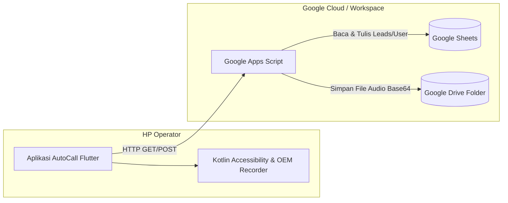
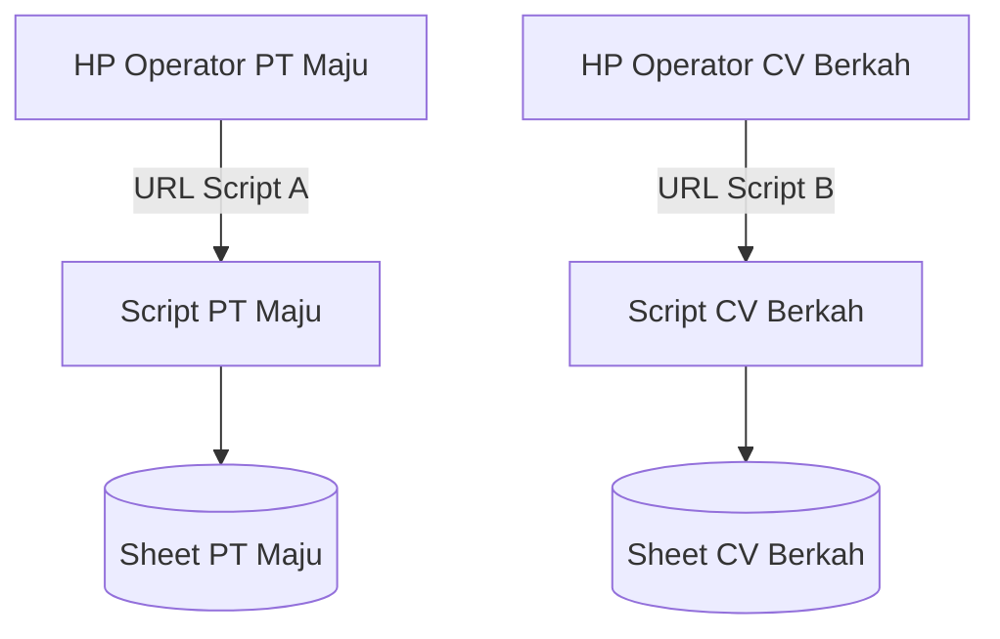
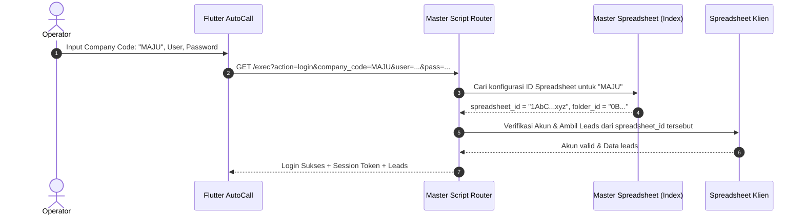
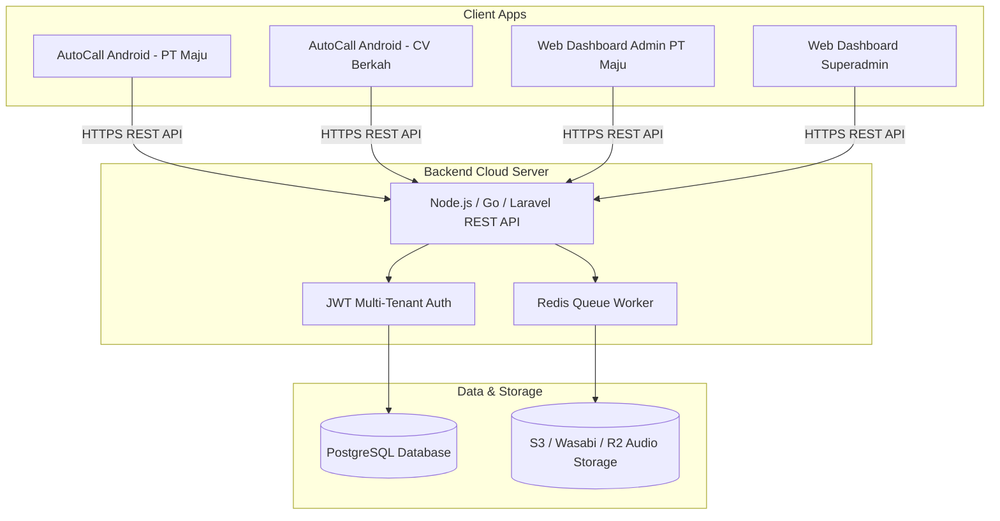
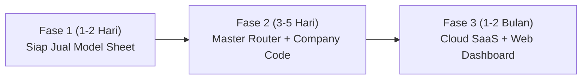

# Dokumen Analisis Teknis & Panduan Implementasi Multi-Company: AutoCall

---

## 1. Ringkasan Eksekutif

> **Jawaban Singkat:**  
> **YA, aplikasi AutoCall ini BISA digunakan dan DIJUAL ke beberapa perusahaan (*multi-company / multi-tenant*).**

Aplikasi saat ini telah memiliki fondasi modular yang kuat:
1. **Frontend (Flutter):** Sistem antrean panggilan berurutan (*sequential queue*), manajemen status (*dialing, in-call, completed, failed*), serta integrasi audio (*playback & library*).
2. **Native Android Engine (Kotlin):** Integrasi *Accessibility Service* untuk automasi klik/dial/hangup, pemindai rekaman bawaan HP (*OEM Call Recording* seperti Vivo/Xiaomi), serta *in-app audio recorder* untuk WhatsApp.
3. **Backend Agnostik (HTTP/REST):** Menggunakan protokol JSON standar via endpoint `doGet` dan `doPost`, yang saat ini berjalan di Google Apps Script (GAS) + Google Sheets + Google Drive.

Untuk dapat dijual ke banyak perusahaan secara aman, rapi, dan terukur (*scalable*), ada beberapa arsitektur teknis dan model bisnis yang dapat dipilih sesuai target pasar Anda.

---

## 2. Kondisi Arsitektur Saat Ini (*As-Is*)



### Karakteristik Sistem Saat Ini:
* **Autentikasi & Kontak:** Diatur via URL Apps Script tunggal (`AKfycbw-3o-.../exec`) yang terhubung langsung ke 1 Spreadsheet spesifik (Tab `Users` dan `Kontak`).
* **Penyimpanan Rekaman:** File suara dikirim dalam format *Base64* via `doPost` ke Apps Script, disimpan di folder Google Drive `"AutoCall Recordings"`, lalu tautannya diisikan kembali ke Spreadsheet dengan formula `=HYPERLINK()`.
* **Kelebihan:** Biaya server Rp 0 (gratis), mudah disiapkan, tidak membutuhkan VPS/server khusus.
* **Tantangan untuk Multi-Company:**
  1. Jika semua perusahaan menggunakan satu spreadsheet yang sama, data kontak dan rekaman akan tercampur.
  2. Google Apps Script memiliki limit kuota harian (*daily quota*) untuk waktu eksekusi (6 menit/eksekusi) dan transfer payload data.
  3. Konfigurasi URL yang panjang menyulitkan operator jika harus memasukkan URL secara manual di HP.

---

## 3. Pilihan Model Arsitektur Multi-Company (*To-Be*)

Ada 4 model arsitektur teknis yang dapat Anda pilih untuk melayani banyak perusahaan:

| Aspek | Model 1: Google Sheets Per-Company | Model 2: Central Router + Multi-Sheets | Model 3: True Cloud SaaS (Rekomendasi Skala Besar) | Model 4: White-Label Custom APK |
| :--- | :--- | :--- | :--- | :--- |
| **Konsep** | 1 Perusahaan = 1 Spreadsheet & Script terpisah | 1 APK + 1 Master Router yang mendistribusikan ke Sheet masing-masing | Backend terpusat (Node.js/Go/Laravel + PostgreSQL + S3 Storage) | 1 Perusahaan = 1 APK Khusus dengan nama & logo perusahaan |
| **Biaya Server** | Rp 0 (Gratis) | Rp 0 (Gratis) | Rp 150rb - 500rb / bulan (VPS + Object Storage) | Rp 0 (atau sesuai backend) |
| **Waktu Siap** | 1 - 2 Hari | 3 - 5 Hari | 2 - 4 Minggu | 2 - 3 Hari per klien |
| **Pemisahan Data** | Sangat Terisolasi (di Drive masing-masing) | Terisolasi per Spreadsheet ID | Terisolasi via `company_id` (Multi-tenant DB) | Terisolasi |
| **Pengalaman Pengguna** | Operator input URL Script perusahaan | Operator hanya input **Company Code** + User/Pass | Operator login via Company Code / Domain | Langsung buka & login tanpa konfigurasi |
| **Kapasitas** | 1 - 5 HP per perusahaan | 5 - 20 perusahaan | Ratusan perusahaan, ribuan operator | Bebas |

---

## 4. Rincian Teknis Implementasi Tiap Model

### Model 1: Google Sheets Terpisah Per-Perusahaan (*Paling Cepat / Zero Cost*)
Sangat cocok untuk tahap awal saat Anda mulai menjual ke 2–5 perusahaan pertama.



* **Langkah Teknis:**
  1. Buatkan salinan (*Make a Copy*) Master Spreadsheet untuk setiap perusahaan baru.
  2. Buka **Ekstensi > Apps Script** di spreadsheet tersebut, lalu **Deploy as Web App** (Akses: *Anyone*).
  3. Berikan URL Web App tersebut kepada perusahaan klien.
  4. Di aplikasi AutoCall klien, buka menu **Pengaturan & API** (atau atur di layar login), masukkan URL Web App perusahaan mereka.
* **Kelebihan:** Privasi klien terjamin karena rekaman dan data telepon ada di Google Drive / Akun Google mereka sendiri.

---

### Model 2: Central Router + Company Code (*User-Friendly & Zero Cost*)
Operator tidak perlu lagi menghafal atau menyalin URL Web App yang panjang. Di layar login cukup memasukkan **Company Code** (misal: `MAJU`, `BERKAH`, `CLIENT01`).



#### Struktur Master Spreadsheet (Index Registry):
| Company Code | Company Name | Spreadsheet ID | Drive Folder ID | Status | Expiry Date |
| :--- | :--- | :--- | :--- | :--- | :--- |
| `MAJU` | PT Maju Jaya | `1A2b3C...` | `0B1c2D...` | `ACTIVE` | 2027-12-31 |
| `BERKAH` | CV Berkah Abadi | `5E6f7G...` | `3H4i5J...` | `ACTIVE` | 2027-06-30 |

#### Potongan Logika Apps Script Master Router (`doGet` / `doPost`):
```javascript
function handleLoginMultiCompany(companyCode, username, password) {
  var masterSS = SpreadsheetApp.getActiveSpreadsheet();
  var registrySheet = masterSS.getSheetByName("Tenants");
  var tenants = registrySheet.getDataRange().getValues();
  
  var targetSpreadsheetId = null;
  var targetFolderId = null;
  var tenantStatus = null;
  
  for (var i = 1; i < tenants.length; i++) {
    if (String(tenants[i][0]).toUpperCase().trim() === String(companyCode).toUpperCase().trim()) {
      targetSpreadsheetId = tenants[i][2];
      targetFolderId = tenants[i][3];
      tenantStatus = tenants[i][4];
      break;
    }
  }
  
  if (!targetSpreadsheetId) {
    return createJsonResponse({ status: 'error', message: 'Company Code tidak terdaftar.' });
  }
  
  if (tenantStatus !== 'ACTIVE') {
    return createJsonResponse({ status: 'error', message: 'Langganan perusahaan Anda telah berakhir.' });
  }
  
  // Buka spreadsheet milik company tersebut secara dinamis
  var clientSS = SpreadsheetApp.openById(targetSpreadsheetId);
  return verifyUserInSheet(clientSS, username, password);
}
```

---

### Model 3: True SaaS Architecture (*Enterprise & High-Scale*)
Jika Anda ingin menjual AutoCall sebagai layanan SaaS profesional berskala puluhan hingga ratusan klien dengan ribuan panggilan harian.



#### Komponen Utama SaaS:
1. **Multi-Tenant Database (PostgreSQL):**
   * Tabel `companies`: `id, code, name, plan, status, expired_at`
   * Tabel `users`: `id, company_id, username, password_hash, role`
   * Tabel `contacts`: `id, company_id, phone, name, status, assigned_user_id`
   * Tabel `call_logs`: `id, company_id, contact_id, user_id, duration, audio_url, created_at`
2. **Audio Storage Cloud:**
   * Simpan file rekaman langsung ke **Cloudflare R2** atau **AWS S3 / Wasabi** (biaya storage audio sangat murah: ~\$0.005/GB atau gratis hingga 10GB pertama).
3. **Web Dashboard untuk Klien (Value Add Tinggi):**
   * Klien Admin tidak perlu buka spreadsheet mentah; mereka memiliki dashboard web modern untuk:
     - Impor daftar nomor (Excel / CSV)
     - Bagi kontak secara otomatis ke HP tiap operator (*smart lead distribution*)
     - Mendengarkan audio rekaman percakapan langsung dari browser
     - Melihat performa operator (jumlah panggilan, panggilan sukses, rata-rata durasi).

---

### Model 4: White-Label Edition (*Private Brand per Perusahaan*)
Untuk klien korporat yang tidak ingin ada merek "AutoCall", melainkan merek internal mereka sendiri (contoh: *"Mandiri TeleCare"*, *"Astra Telesales"*).

* **Teknis di Flutter:**
  Gunakan fitur **Flutter Flavors**:
  ```bash
  # Build untuk Company A
  flutter build apk --flavor companyA -t lib/main_company_a.dart
  
  # Build untuk Company B
  flutter build apk --flavor companyB -t lib/main_company_b.dart
  ```
  Setiap *flavor* memiliki:
  * Application ID / Package Name berbeda (misal: `com.perusahaana.autodialer`)
  * Nama aplikasi, ikon logo, dan warna tema (*color scheme*) berbeda
  * URL Backend yang sudah langsung terkunci (*pre-configured*), sehingga operator tinggal *install & login*.

---

## 5. Aspek Teknis Android & Hardware yang Wajib Diketahui

Sebelum menjual ke klien, berikut adalah aspek teknis krusial yang wajib diinformasikan dalam panduan implementasi hardware mereka:

### 1. Perekaman Panggilan GSM (Native Phone)
* **Kondisi Android:** Google telah membatasi API rekaman panggilan suara pada aplikasi pihak ketiga sejak Android 10+.
* **Solusi AutoCall:** Memanfaatkan fitur **Perekaman Panggilan Otomatis bawaan sistem HP (*OEM Built-in Recorder*)** seperti pada ponsel **Vivo (FuntouchOS), Xiaomi/Redmi (MIUI/HyperOS), Oppo/Realme (ColorOS), atau Samsung**.
* **Rekomendasi ke Klien:** Berikan daftar tipe HP yang direkomendasikan (misal: Vivo Y-series atau Xiaomi Redmi dengan dialer bawaan aktif rekaman otomatis).

### 2. Perekaman WhatsApp Call
* Menggunakan fitur *in-app recording* (`WhatsAppAudioRecorder.kt`) yang sudah terpasang di AutoCall.
* **Syarat:** Operator wajib menyalakan **Speaker (Handsfree)** saat menelepon via WhatsApp agar suara lawan bicara tertangkap jelas oleh mikrofon perangkat.

### 3. Izin Aksesibilitas (*Accessibility Service*)
* Digunakan untuk otomatisasi menekan tombol panggilan, auto-hangup setelah timeout, dan mendeteksi jendela WhatsApp.
* Di Android 13 dan 14+: Pengguna wajib membuka kunci izin pada:  
  *Pengaturan HP > Aplikasi > AutoCall > Titik 3 di pojok kanan atas > "Izinkan setelan terbatas" (Allow restricted settings)*.

---

## 6. Model Monetisasi & Strategi Penjualan

| Skema Penjualan | Target Pasar | Kisaran Harga | Deskripsi |
| :--- | :--- | :--- | :--- |
| **SaaS Langganan per Device / Bulan** | UMKM, Tim Sales, Asuransi, Properti | Rp 50.000 – Rp 150.000 / HP / bulan | Klien membayar sesuai jumlah HP operator yang aktif. Pembayaran berulang (*recurring revenue*). |
| **SaaS Langganan per Perusahaan** | Kantor Call Center menengah (5–20 HP) | Rp 500.000 – Rp 1.500.000 / bulan | Akses tanpa batas jumlah HP dalam 1 perusahaan, mencakup Google Sheet terintegrasi. |
| **Lisensi Jual Putus / Setup Fee** | Korporat / Instansi Tertutup | Rp 15.000.000 – Rp 50.000.000 (One-time) | Instalasi sistem mandiri (*on-premise*) di akun Google / server klien + *custom branding* (White-label). |
| **Biaya Tambahan (Add-on)** | Klien yang butuh kustomisasi | Rp 2.000.000 – Rp 5.000.000 | Integrasi dengan CRM internal klien, webhook laporan WhatsApp otomatis, atau custom format spreadsheet. |

---

## 7. Rencana Aksi Implementasi (*Step-by-Step Roadmap*)



### Langkah Cepat yang Dapat Dikerjakan Sekarang:
1. **Tambahkan Input "Company Code" di Layar Login (`login_screen.dart`):**
   * Tambahkan kolom input teks opsional/wajib: `Kode Perusahaan`.
   * Simpan di `SharedPreferences`.
2. **Kunci Default URL ke Master Gateway:**
   * Buat 1 Google Apps Script Gateway yang memetakan kode perusahaan ke ID Spreadsheet masing-masing.
3. **Sediakan Paket Penjualan (SOP Klien):**
   * Template Google Spreadsheet master siap pakai (*Copy-paste ready*).
   * Buku petunjuk singkat aktivasi HP (Vivo/Xiaomi, Play Protect, Aksesibilitas).
   * File APK siap unduh.

---

> [!NOTE]
> Seluruh kode sumber AutoCall yang ada saat ini sudah mendukung pengubahan URL secara dinamis (`AuthProvider.setLoginApiUrl` dan `CallQueueProvider.setContactsApiUrl`), sehingga transisi ke sistem Multi-Company dapat dilakukan tanpa perlu merombak ulang arsitektur dasar aplikasi.

