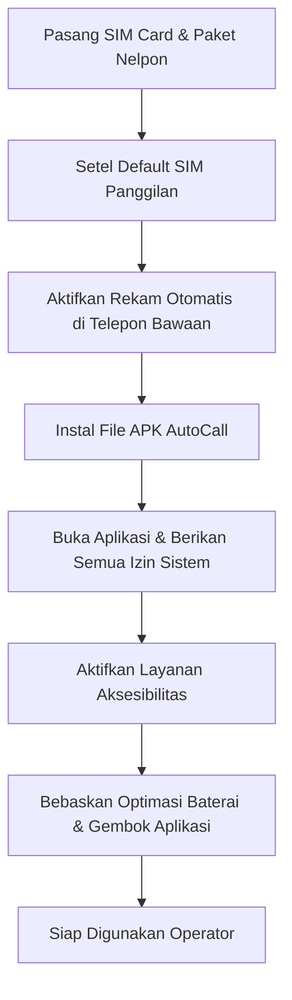

# Panduan Lengkap Pengguna & Persyaratan Perangkat: Aplikasi AutoCall

Dokumen ini ditujukan bagi **konsumen, admin, supervisor, dan operator telemarketing/call center** yang baru pertama kali akan memasang (*install*), mengonfigurasi, dan menggunakan aplikasi **AutoCall**. 

Pastikan membaca bagian **Persyaratan Perangkat & Fitur Wajib HP** sebelum memilih atau membeli unit handphone yang akan digunakan.

---

## Daftar Isi
1. [Mengenal Aplikasi AutoCall](#1-mengenal-aplikasi-autocall)
2. [Spesifikasi & Persyaratan Perangkat (Device Requirements)](#2-spesifikasi--persyaratan-perangkat-device-requirements)
3. [Fitur Wajib yang Harus Dimiliki Handphone](#3-fitur-wajib-yang-harus-dimiliki-handphone)
4. [Rekomendasi Merk & Tipe Handphone](#4-rekomendasi-merk--tipe-handphone)
5. [Langkah-Langkah Instalasi & Pengaturan Awal (Wajib Sekali Setting)](#5-langkah-langkah-instalasi--pengaturan-awal-wajib-sekali-setting)
6. [Panduan Penggunaan Aplikasi Sehari-hari](#6-panduan-penggunaan-aplikasi-sehari-hari)
7. [Memeriksa & Memutar Rekaman (Pustaka Rekaman)](#7-memeriksa--memutar-rekaman-pustaka-rekaman)
8. [Panduan Pemecahan Masalah (Troubleshooting / FAQ)](#8-panduan-pemecahan-masalah-troubleshooting--faq)

---

## 1. Mengenal Aplikasi AutoCall

**AutoCall** adalah aplikasi produktivitas telepon otomatis (*predictive / sequential auto-dialer*) berbasis Android yang dirancang khusus untuk tim penjualan (*telemarketing*), penagihan (*telecollection*), survei, dan layanan pelanggan (*customer service*).

### Manfaat Utama bagi Operasional:
* **Hemat Waktu & Tenaga:** Operator tidak perlu mengetik nomor kontak satu per satu di papan tombol. Panggilan dilakukan secara berurutan (*sequential queue*) otomatis.
* **Auto-Hangup Saat Timeout:** Jika nomor yang dihubungi tidak diangkat, sibuk, atau mailbox/tidak aktif, sistem otomatis memutus panggilan sesuai durasi yang ditentukan (misal 25 detik).
* **Perekaman Panggilan Otomatis:** Percakapan telepon otomatis tersimpan dan dapat disinkronkan ke server/Google Drive untuk kebutuhan evaluasi mutu (*quality control*).
* **Dua Mode Panggilan:** Mendukung **Panggilan Seluler (GSM)** dan **Panggilan WhatsApp (VoIP Call)**.
* **Sinkronisasi Database:** Terhubung langsung dengan server database (RDD Online / Google Sheets) untuk menarik kontak dan memperbarui status panggilan secara *real-time*.

---

## 2. Spesifikasi & Persyaratan Perangkat (Device Requirements)

Untuk memastikan aplikasi bekerja lancar tanpa hambatan di latar belakang (*background*), perangkat handphone yang digunakan harus memenuhi spesifikasi berikut:

| Komponen | Spesifikasi Minimum | Spesifikasi yang Direkomendasikan |
| :--- | :--- | :--- |
| **Sistem Operasi (OS)** | Android 8.0 (Oreo / API 26) | **Android 11, 12, atau 13** |
| **Kapasitas RAM** | 3 GB RAM | **4 GB s/d 8 GB RAM** |
| **Memori Internal** | Sisa ruang kosong min. 8 GB | **Sisa ruang kosong 16 GB - 32 GB** |
| **Prosesor (CPU)** | Quad-Core 1.8 GHz | **Octa-Core (MediaTek Dimensity / Snapdragon)** |
| **Baterai** | 4.000 mAh | **5.000 mAh atau lebih** *(karena aktivitas telepon intensif)* |
| **Jaringan & Koneksi** | 4G LTE / Wi-Fi stabil | **4G LTE / 5G / Wi-Fi kencang & stabil** |
| **Kartu SIM** | 1 Kartu SIM aktif dengan paket telepon/pulsa | **Paket nelpon unlimited ke semua operator** |

> [!IMPORTANT]
> **Mengapa RAM & Memori Internal Cukup Penting?**  
> Saat proses autocall berjalan, HP mengeksekusi beberapa proses sekaligus: aplikasi AutoCall, aplikasi Telepon/Dialer bawaan, sistem perekam suara, floating widget di atas layar, dan proses pengunggahan file audio ke cloud. RAM 4 GB ke atas menjamin sistem operasi tidak membekukan (*freeze*) aplikasi di tengah jalan.

---

## 3. Fitur Wajib yang Harus Dimiliki Handphone

Sebelum membagikan HP ke operator, pastikan unit HP memiliki fitur dan kemampuan sistem berikut ini:

```
┌─────────────────────────────────────────────────────────────────────────┐
│               FITUR SISTEM WAJIB PADA PERANGKAT HP                      │
├─────────────────────────────────────────────────────────────────────────┤
│ 1. [WAJIB] Perekam Panggilan Otomatis Bawaan Pabrik (Native OEM Dialer) │
│ 2. [WAJIB] Dukungan Layanan Aksesibilitas (Accessibility Service)      │
│ 3. [WAJIB] Izin Tampilkan di Atas Aplikasi Lain (Display Overlays)       │
│ 4. [WAJIB] Izin Pengelolaan Semua File (All Files Access / Storage)     │
│ 5. [WAJIB] Pengaturan Bebaskan Optimasi Baterai (Unrestricted Battery)  │
│ 6. [WAJIB] Pengaturan Default SIM Panggilan (Untuk HP Dual SIM)        │
└─────────────────────────────────────────────────────────────────────────┘
```

### 1. Perekam Panggilan Otomatis Bawaan HP (CRITICAL REQUIREMENT)
* **Latar Belakang Teknis:** Sejak Android versi 9 dan 10 ke atas, Google menerapkan aturan keamanan ketat yang **melarang** seluruh aplikasi pihak ketiga merekam suara dua arah (suara lawan bicara) pada panggilan GSM biasa secara langsung melalui mikrofon internal.
* **Solusi Sistem AutoCall:** AutoCall memanfaatkan **fitur perekam panggilan bawaan pabrik (OEM Native Call Recorder)** yang terdapat di dialer bawaan HP. Ketika panggilan terjadi, dialer HP merekam suara dengan jernih. Begitu panggilan selesai, AutoCall akan membaca file rekaman tersebut dari memori dan mengunggahnya ke server.
* **Akibat Jika HP Tidak Memiliki Fitur Ini:** Panggilan otomatis dan auto-hangup tetap berjalan normal, namun file rekaman suara percakapan GSM **tidak akan tersedia/kosong** (suara lawan bicara tidak terekam).

### 2. Layanan Aksesibilitas (*Accessibility Service*)
* Fitur sistem operasi Android yang mengizinkan aplikasi AutoCall mendeteksi tampilan layar saat panggilan telepon berlangsung dan secara cerdas **menekan tombol merah (Tutup Panggilan)** ketika durasi tunggu atau durasi panggilan telah mencapai batas waktu (*timeout*).
* Tanpa fitur ini, operator harus menutup telepon secara manual setiap kali nomor tidak diangkat.

### 3. Tampilkan di Atas Aplikasi Lain (*Display Over Other Apps / Floating Overlay*)
* Fitur yang mengizinkan AutoCall memunculkan *widget* melayang kecil di layar saat panggilan berlangsung (menampilkan hitung mundur waktu tunggu, status, dan tombol jeda).
* Fitur ini juga menjaga proses sistem agar tidak dimatikan paksa oleh sistem operasi saat layar telepon sedang aktif.

### 4. Akses Pengelolaan Semua File (*All Files Access / MANAGE_EXTERNAL_STORAGE*)
* Di Android 11, 12, 13, dan 14, sistem membatasi akses folder. Fitur ini wajib diaktifkan agar AutoCall diizinkan mencari dan membaca file audio rekaman dari folder sistem (seperti folder `/Recordings/Call/` atau `/Music/PhoneRecord/`).

### 5. Dukungan Pembebasan Baterai (*Ignore Battery Optimization*)
* HP harus mengizinkan aplikasi AutoCall disetel ke mode **"Tidak Dibatasi / Unrestricted"**. Jika tidak, fitur hemat daya bawaan HP akan mematikan aplikasi setelah 5–10 menit berjalan di latar belakang.

---

## 4. Rekomendasi Merk & Tipe Handphone

Berdasarkan arsitektur pembacaan file rekaman dan integrasi dialer otomatis, berikut adalah panduan merk HP yang sangat cocok maupun yang perlu dihindari:

### A. Merk yang SANGAT DIREKOMENDASIKAN (Pilihan Terbaik)

| Merk HP | Antarmuka (OS) | Status Rekam Otomatis Bawaan | Lokasi Folder Rekaman | Catatan |
| :--- | :--- | :--- | :--- | :--- |
| **Vivo / iQOO** | Funtouch OS / OriginOS | **Sangat Baik (Bawaan Ada)** | `Recordings/Call` | **Paling Direkomendasikan.** Dialer bawaan stabil, rekaman dua arah sangat jernih, integrasi tutup otomatis sangat mulus. |
| **Infinix** | XOS | **Sangat Baik (Bawaan Ada)** | `Music/PhoneRecord` | **Sangat Direkomendasikan & Ekonomis.** Fitur auto-call record langsung aktif di dialer tanpa suara peringatan. |
| **Tecno / itel** | HiOS / itelOS | **Sangat Baik (Bawaan Ada)** | `Music/PhoneRecord` | Satu grup dengan Infinix (Transsion), sangat ekonomis untuk armada telemarketing skala besar. |
| **Samsung** | One UI (Versi Resmi Indonesia) | **Baik (Bawaan Ada)** | `Recordings/Call` | Pastikan menggunakan unit garansi resmi SEIN (Indonesia) yang memiliki menu "Rekam Panggilan Otomatis" di aplikasi Telepon bawaan. |
| **Oppo / Realme** | ColorOS / Realme UI | **Baik (Bawaan Ada)** | `Recordings/Call Recordings` | Unit yang menggunakan aplikasi Telepon bawaan ColorOS mendukung auto-record dengan rapi. |
| **Xiaomi / Redmi / POCO** | MIUI / HyperOS | **Cukup Baik** | `MIUI/sound_recorder/call_rec` | Pastikan menggunakan ROM Indonesia yang menyediakan menu rekam panggilan otomatis bawaan di setelan telepon. |

### B. Merk / Tipe yang TIDAK DIREKOMENDASIKAN untuk Mode Panggilan GSM
* **Google Pixel:** Menggunakan Google Phone murni yang tidak mengizinkan perekaman otomatis tanpa suara notifikasi peringatan.
* **Handphone Unit Pasar Luar Negeri / Non-Resmi (ROM USA, Eropa, atau Jepang):** Di negara-negara tersebut rekaman telepon dilarang oleh undang-undang, sehingga menu rekaman otomatis dinonaktifkan oleh pabrik di level sistem firmware.
* **HP yang hanya memiliki Google Dialer:** Perekam panggilan Google Dialer selalu mengeluarkan suara lantang *"Panggilan ini sekarang direkam"* yang terdengar oleh lawan bicara dan tidak dapat merekam otomatis tanpa diklik manual.

*(Catatan: Untuk **Mode Panggilan WhatsApp**, semua merk Android di atas dapat digunakan karena aplikasi AutoCall memiliki modul perekam suara internal khusus untuk WhatsApp).*

---

## 5. Langkah-Langkah Instalasi & Pengaturan Awal (Wajib Sekali Setting)

Lakukan tahapan konfigurasi berikut pada handphone baru sebelum aplikasi diserahkan ke operator:



### Langkah 1: Kunci Pilihan Kartu SIM (PENTING untuk HP Dual SIM)
Jika HP memiliki dua slot kartu SIM, pastikan sistem tidak memunculkan jendela pilihan setiap kali menelepon:
1. Buka **Pengaturan HP** -> **Jaringan Seluler** / **Kartu SIM**.
2. Cari menu **Panggilan / Panggilan Suara (Calls)**.
3. Ubah dari *"Selalu Tanya / Ask Every Time"* menjadi kartu SIM yang memiliki paket nelpon (misal: **SIM 1**).

### Langkah 2: Aktifkan Rekaman Panggilan Otomatis di HP
1. Buka aplikasi **Telepon / Dialer** (ikon telepon hijau/biru bawaan pabrik).
2. Ketuk ikon **Titik Tiga (⋮)** atau **Ikon Gerigi** di pojok kanan atas untuk membuka **Pengaturan Panggilan**.
3. Pilih menu **Rekaman Panggilan** (*Call Recording*).
4. Aktifkan sakelar **"Rekam Semua Panggilan Otomatis"** (*Record all calls automatically*).
5. Lakukan uji coba panggilan ke nomor sembarang selama 5 detik, lalu pastikan file rekaman tersimpan di galeri/folder audio HP Anda.

### Langkah 3: Menginstal File APK AutoCall
1. Salin atau unduh file instalasi APK AutoCall ke memori handphone.
2. Buka file APK tersebut via *Pengelola File (File Manager)*.
3. Jika muncul pop-up *"Demi keamanan, ponsel Anda tidak diizinkan menginstal aplikasi tidak dikenal dari sumber ini"*, ketuk **Setelan** lalu aktifkan **"Izinkan dari sumber ini"**.
4. Ketuk **Instal** dan tunggu hingga proses selesai.

### Langkah 4: Memberikan Izin Sistem Pertama Kali
1. Buka aplikasi **AutoCall**.
2. Pada layar utama (atau klik ikon **Perisai / Status Izin** di bagian kanan atas), akan muncul daftar izin yang dibutuhkan:
   * **Panggilan Telepon (`CALL_PHONE`)** -> Ketuk **Izinkan** (agar aplikasi bisa langsung mendial).
   * **Status Telepon (`READ_PHONE_STATE`)** -> Ketuk **Izinkan** (mendeteksi saat telepon diangkat atau selesai).
   * **Riwayat Panggilan (`READ_CALL_LOG`)** -> Ketuk **Izinkan** (membaca durasi aktual panggilan).
   * **Mikrofon (`RECORD_AUDIO`)** -> Ketuk **Izinkan** (digunakan untuk rekaman mode WhatsApp).
   * **Akses Semua File (`MANAGE_EXTERNAL_STORAGE`)** -> Sistem akan membuka menu Pengaturan -> Cari **AutoCall** -> Nyalakan sakelar **"Izinkan pengelolaan semua file"**.
   * **Tampilkan di Atas Aplikasi Lain (Overlay)** -> Sistem akan membuka menu Pengaturan -> Cari **AutoCall** -> Aktifkan **"Izinkan ditampilkan di atas aplikasi lain"**.
   * **Bebaskan Optimasi Baterai** -> Ketuk Izinkan pada jendela pop-up sistem (*Unrestricted / Jangan Optimalkan*).

### Langkah 5: Mengaktifkan Layanan Aksesibilitas (AutoCall Assistant)
Izin ini yang membuat aplikasi mampu memutus panggilan telepon secara otomatis tanpa dipencet manual:
1. Klik tombol **"Buka Pengaturan Aksesibilitas"** di aplikasi AutoCall (atau buka *Pengaturan HP* -> *Aksesibilitas*).
2. Cari menu **Aplikasi yang Didownload / Layanan Terinstal** (*Downloaded Apps / Installed Services*).
3. Ketuk nama **AutoCall** (atau *AutoCall Assistant*).
4. Nyalakan sakelar **Gunakan AutoCall** -> Muncul peringatan konfirmasi sistem -> Ketuk **Izinkan / OK**.

### Langkah 6: Mengunci Aplikasi di Layar Recent Apps (Gembok Aplikasi)
Agar sistem manajemen RAM HP tidak menutup AutoCall saat operator beralih aplikasi:
1. Buka tampilan daftar aplikasi terakhir dibuka (*Recent Apps / Overview Screen*).
2. Temukan jendela aplikasi **AutoCall**.
3. Ketuk ikon titik tiga atau tekan tahan thumbnail jendela aplikasi, lalu pilih **Kunci (Lock / Ikon Gembok)**.
4. Ikon gembok kecil akan muncul di sudut jendela aplikasi AutoCall.

---

## 6. Panduan Penggunaan Aplikasi Sehari-hari

Setelah langkah instalasi awal selesai, operator dapat mulai bekerja dengan langkah mudah berikut:

### 1. Masuk / Login
1. Buka aplikasi **AutoCall**.
2. Masukkan **Username** dan **Kata Sandi** yang telah didaftarkan oleh administrator.
3. Ketuk tombol **Masuk**.
4. Setelah berhasil, aplikasi akan menampilkan ucapan selamat datang beserta nama operator yang bertugas.

### 2. Memilih Mode Panggilan
Di bagian atas layar antrean terdapat tab pemilihan mode panggilan:
* **Panggilan GSM (Kartu SIM):** Memilih panggilan nomor seluler biasa menggunakan pulsa/paket operator.
* **Panggilan WhatsApp:** Memilih panggilan berbasis VoIP melalui aplikasi WhatsApp / WhatsApp Business.

### 3. Menyiapkan Antrean Nomor Prospek
Aplikasi menyediakan beberapa cara praktis untuk memasukkan nomor tujuan:

#### Cara A: Tarik Otomatis dari Server (Direkomendasikan)
* Ketuk tombol **"Ambil Nomor (RDD Online)"** atau tarik layar ke bawah (*pull to refresh*).
* Sistem akan otomatis mengambil daftar kontak prospek yang ditugaskan khusus untuk ID operator yang sedang login.

#### Cara B: Input Manual Satu Nomor
1. Ketuk tombol **"Input Manual"**.
2. Pada tab **"Satu Nomor"**, masukkan nomor telepon (contoh: `081234567890`) dan nama prospek.
3. Ketuk **"Tambahkan ke Antrean"**.

#### Cara C: Tempel Banyak Nomor Sekaligus (Batch / Paste)
1. Ketuk tombol **"Input Manual"** -> Pilih tab **"Batch / Paste"**.
2. Tempelkan daftar nomor dari WhatsApp, Notepad, atau Excel (satu nomor per baris, bisa berupa format `0812xxx - Budi Santoso`).
3. Ketuk **"Proses & Masukkan Antrean"**.

### 4. Mengatur Waktu Tunggu (Timeout) & Jeda Aman
Ketuk ikon **Pengaturan (Gerigi)** di pojok kanan atas untuk menyesuaikan:
* **Batas Waktu Tunggu Panggilan (Call Timeout):**  
  * Rentang: 15 – 45 detik (Standar rekomendasi: **25 detik**).  
  * Jika dalam 25 detik panggilan nada dering tidak kunjung diangkat atau nomor berada di luar jangkauan, sistem otomatis menutup panggilan.
* **Jeda Aman Antar Panggilan (Cooldown Delay):**  
  * Rentang: 5 – 15 detik (Standar rekomendasi: **6 – 8 detik**).  
  * Memberikan jeda aman agar kartu SIM tidak diblokir oleh operator seluler akibat panggilan beruntun terlalu cepat, serta memberikan waktu bagi sistem HP untuk merapikan penyimpanan file audio rekaman.

### 5. Menjalankan Autocall
1. Periksa ikon perisai di kanan atas: pastikan berwarna **Hijau (Verified)**.
2. Ketuk tombol hijau besar **"Mulai Autocall"**.
3. Aplikasi akan otomatis menghubungi kontak nomor pertama:
   * Layar panggilan telepon akan terbuka.
   * Sebuah **widget melayang (*floating countdown*)** akan muncul di layar menampilkan sisa detik hitung mundur waktu tunggu.
4. **Kondisi Skenario:**
   * **Jika Tidak Diangkat / Sibuk:** Saat hitung mundur habis (misal detik ke-25), sistem aksesibilitas akan otomatis menekan tombol merah tutup panggilan.
   * **Jika Diangkat oleh Prospek:** Operator berbicara seperti biasa. Begitu pembicaraan selesai, tekan tombol tutup di layar telepon.
5. Aplikasi AutoCall akan kembali ke layar antrean, menghitung mundur jeda aman (*cooldown* misal 6 detik), mencari file rekaman, mengunggah data status ke server, lalu langsung mendial nomor berikutnya secara otomatis.

### 6. Kendali Panggilan (Pause, Stop, & Requeue)
* **Tombol Pause (Jeda):** Ketuk tombol ini jika operator ingin beristirahat sejenak, minum, atau mencatat hasil percakapan. Panggilan berikutnya tidak akan dijalankan sampai tombol **"Lanjutkan"** ditekan.
* **Tombol Stop:** Menghentikan seluruh proses antrean secara penuh.
* **Tombol Ulangi Panggilan Gagal (Ikon Refresh Melingkar):** Jika proses selesai, operator dapat menekan tombol ini untuk otomatis memasukkan kembali nomor-nomor yang tadi tidak diangkat / sibuk ke dalam antrean putaran kedua.

---

## 7. Memeriksa & Memutar Rekaman (Pustaka Rekaman)

Aplikasi AutoCall dilengkapi dengan fitur pemutar audio bawaan (*built-in audio player*):

1. Ketuk ikon **Pustaka Musik (Library Music)** di bagian kanan atas aplikasi.
2. Jendela dialog akan menampilkan seluruh daftar file rekaman panggilan yang ada di penyimpanan handphone Anda:
   * Nama file & nomor telepon tujuan.
   * Tanggal dan jam percakapan.
   * Ukuran file audio.
3. **Memutar Suara:** Ketuk ikon tombol **Play (▶)** di samping file untuk mendengarkan kembali hasil pembicaraan langsung di dalam aplikasi tanpa perlu membuka pemutar musik eksternal.
4. Terdapat fitur pencarian (*search bar*) untuk mencari rekaman berdasarkan nomor HP tertentu.

---

## 8. Panduan Pemecahan Masalah (Troubleshooting / FAQ)

Berikut solusi cepat jika menemukan kendala teknis di lapangan:

### Q1: Mengapa aplikasi tidak menutup panggilan otomatis saat waktu timeout habis?
* **Penyebab:** Izin Layanan Aksesibilitas (*Accessibility Service*) belum aktif atau sempat dinonaktifkan oleh pembersihan sistem HP.
* **Solusi:** Buka menu status izin di kanan atas aplikasi, ketuk pada bagian *Layanan Tutup Otomatis (Aksesibilitas)*, dan pastikan sakelar **AutoCall** dalam posisi **ON (Aktif)**.

---

### Q2: Mengapa hasil rekaman panggilan GSM kosong atau suara lawan bicara tidak terdengar?
* **Penyebab:** Fitur rekam otomatis bawaan dialer HP belum dinyalakan, atau HP yang digunakan tidak memiliki fitur rekam bawaan pabrik (misal menggunakan HP Google Pixel atau ROM Luar Negeri).
* **Solusi:** Buka aplikasi Telepon bawaan HP -> Setelan Panggilan -> Aktifkan **"Rekam Semua Panggilan Secara Otomatis"**. Pastikan juga izin **"Akses Pengelolaan Semua File"** di AutoCall sudah diaktifkan.

---

### Q3: Mengapa setiap kali mendial nomor selalu muncul pop-up pilihan SIM 1 atau SIM 2?
* **Penyebab:** Pengaturan SIM Panggilan pada sistem Android masih disetel ke *"Selalu Tanya / Ask Every Time"*.
* **Solusi:** Buka *Pengaturan HP* -> *Jaringan & Kartu SIM* -> *Panggilan Suara* -> Kunci pilihan ke **SIM 1** (atau SIM yang Anda gunakan).

---

### Q4: Mengapa aplikasi AutoCall berhenti sendiri saat layar handphone mati atau ditinggal beberapa menit?
* **Penyebab:** Fitur penghemat baterai cerdas (*Smart Battery Saver*) bawaan HP mematikan proses di latar belakang.
* **Solusi:**
  1. Buka *Pengaturan HP* -> *Aplikasi* -> *AutoCall* -> *Baterai* -> Pilih **"Tidak Dibatasi / Unrestricted"**.
  2. Buka layar *Recent Apps*, tekan lama jendela AutoCall, lalu pilih **Kunci / Gembok (Lock App)**.

---

### Q5: Apakah panggilan WhatsApp bisa merekam percakapan dua arah?
* **Jawaban:** **Bisa.** Pada mode WhatsApp, AutoCall menggunakan modul perekam internal khusus (*internal audio recorder*). Pastikan izin Mikrofon (`RECORD_AUDIO`) telah disetujui. Disarankan menggunakan *speakerphone* atau volume percakapan yang cukup agar suara lawan bicara tertangkap secara maksimal dan jernih.

---

### Q6: Bagaimana jika nomor antrean prospek tidak muncul saat login?
* **Penyebab:** Koneksi internet terputus, atau akun operator belum memiliki data prospek yang ditugaskan di server database / Google Spreadsheet.
* **Solusi:** 
  1. Periksa koneksi internet (pastikan paket data atau Wi-Fi aktif).
  2. Tarik layar ke bawah (*pull to refresh*) untuk mencoba sinkronisasi ulang.
  3. Hubungi administrator/supervisor untuk memastikan nama/ID operator sudah didaftarkan di baris data kontak server.

---

*Dokumen ini disusun untuk memastikan kelancaran operasional pengguna AutoCall. Untuk bantuan teknis lebih lanjut, silakan hubungi tim IT Support atau Administrator sistem perusahaan Anda.*

